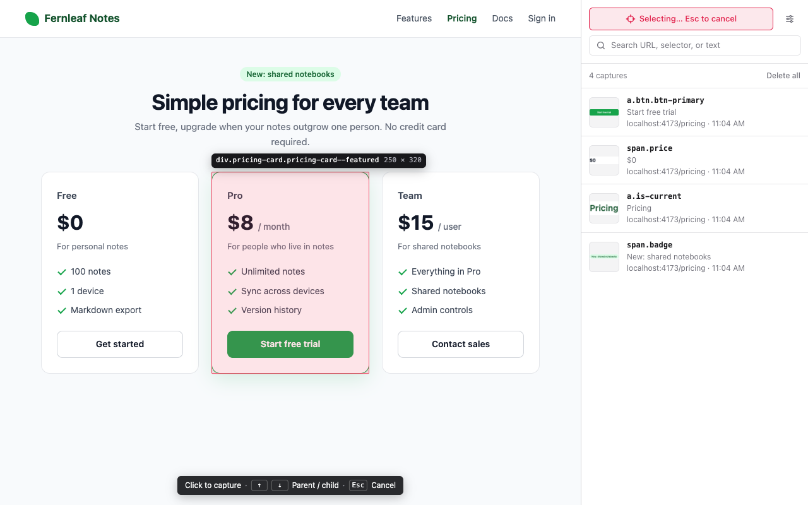
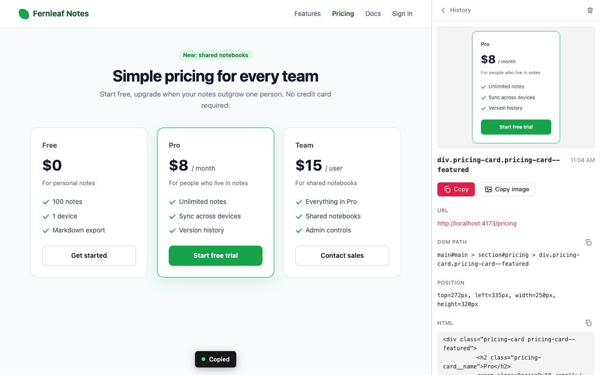

# DOM Sniper

[日本語](README.ja.md)

A Chrome extension for people who build web pages with AI coding assistants. Click any element on a page and DOM Sniper copies what the assistant needs to find it in your code: the page URL, a CSS selector path, the element's position, and its HTML. Every capture is also kept in a searchable history in Chrome's side panel.



## What gets copied

```
URL: http://localhost:4173/pricing
DOM Path: main#main > section#pricing > div.pricing-card.pricing-card--featured
Position: top=272px, left=335px, width=250px, height=320px
HTML Element: <div class="pricing-card pricing-card--featured">Pro $8 / month For people who live in notes Unlimited notes Sync across devices Version history Start free trial</div>
```

Paste it into your assistant together with what you want changed.

The format follows the element picker in Cursor's built-in browser, with two differences: the URL is included, and **DOM Path is a valid CSS selector**. Classes are joined with `.`, special characters (such as Tailwind's `md:flex`) are escaped, and `:nth-child()` is added only where siblings would otherwise match, so the path can be passed straight to `document.querySelector`.

## Features

- **Element picker** – hover to highlight, click to capture. Move to the parent or child element with the keyboard when the element you want is covered by another one.
- **Works where clicking is awkward** – hover menus stay open while you pick, and elements inside modal `<dialog>`s and open shadow roots can be selected.
- **History in the side panel** – every capture is saved with a screenshot of the element. Search by URL, selector, text, or HTML, and copy any capture again.
- **Screenshot of the element** – view it in the detail page or copy it as an image to paste next to the text.
- **Settings** – switch the language (English / Japanese) and rebind the picker keys.
- **Local only** – the extension makes no network requests. See [Privacy](#permissions-and-privacy).



## Install

DOM Sniper is not on the Chrome Web Store yet. Until it is, install it from a release or build it yourself. Chrome 114 or later is required.

### From a release

1. Download `dom-sniper-<version>-chrome.zip` from the [latest release](https://github.com/furdabu/dom-sniper/releases/latest) and unzip it.
2. Open `chrome://extensions`, turn on **Developer mode**, choose **Load unpacked**, and select the unzipped folder.

### From source

You need Node.js 22 and [pnpm](https://pnpm.io/).

```sh
pnpm install
pnpm build
```

Then load the `.output/chrome-mv3` folder the same way.

## Usage

1. Click the DOM Sniper icon in the toolbar to open the side panel.
2. Press **Select element** in the side panel, or use the shortcut `Alt+Shift+S` (`⌥⇧S` on macOS).
3. Hover the element you want and click it. The text is copied to the clipboard and the capture appears in the history.
4. Paste it into your assistant.

While selecting:

| Key | Action |
| --- | --- |
| `↑` | Select the parent element |
| `↓` | Go back toward the element under the pointer |
| `Esc` | Cancel |

## Settings

Open the settings from the icon next to **Select element**.

- **Language** – match the browser, English, or Japanese. The side panel and the on-page guide switch immediately.
- **Keys** – click a key, then press the one you want to assign. Keys are single keys without modifiers and are matched by physical position, so they keep working while an IME is on. Choosing a key that another action already uses swaps the two.
- **Start shortcut** – Chrome manages this shortcut, so it is changed on `chrome://extensions/shortcuts`. The settings page shows the current one and has a button that opens that page.

Settings are stored in Chrome's sync storage and follow you to other Chrome browsers signed in to the same account.

## Permissions and privacy

| Permission | Why it is needed |
| --- | --- |
| Access to all sites | To add the picker to the tab where you start selecting, and to take the screenshot of the element you click. Nothing runs on a page until you start selecting on it. |
| `scripting` | To inject the picker on demand instead of running a script on every page. |
| `sidePanel` | To show the history and settings in the side panel. |
| `storage` | To save the language and key settings. |

Captures (URL, page title, selector, HTML, text, and screenshot) are stored only in the browser, in the extension's own IndexedDB. Nothing is sent anywhere. The full policy is in [PRIVACY.md](PRIVACY.md).

## Limitations

- Elements inside an `<iframe>` cannot be selected; the iframe itself is selected instead. The same applies to closed shadow roots.
- The screenshot covers only what is visible in the viewport. An element larger than the viewport is cropped to its visible part.
- Chrome does not allow extensions on some pages, such as `chrome://` pages and the Chrome Web Store.
- A DOM Path that crosses a shadow root uses ` >>> ` at the boundary, which CSS cannot express, so that path cannot be passed to `querySelector` as is.
- The history keeps the latest 500 captures, and the saved HTML of one element is truncated at 20,000 characters.

## Development

Built with [WXT](https://wxt.dev/), React, [TanStack Router](https://tanstack.com/router), and SCSS.

| Command | What it does |
| --- | --- |
| `pnpm dev` | Development build with hot reload |
| `pnpm build` | Production build in `.output/chrome-mv3` |
| `pnpm zip` | Zip file for the Chrome Web Store in `.output/` |
| `pnpm compile` | Type check |
| `pnpm icons` | Regenerate the icons in `public/icon/` |

```
entrypoints/
  background/       Service worker: injects the picker, takes screenshots, saves captures
  picker.content/   Content script: element picker, overlay, selector path, clipboard
  sidepanel/        Side panel UI: history, capture detail, settings
lib/                Code shared between them: storage, settings, messages, i18n
public/_locales/    Strings used by the manifest (description, shortcut name)
```

### Releasing

GitHub Actions builds every push to `main` and every pull request. When the `version` in `package.json` has no release yet, the same run publishes a GitHub release named `v<version>` with the zip attached, so releasing is: bump `version`, then push to `main`. That zip can be uploaded to the Chrome Web Store as is.

### Adding a language

1. Copy `lib/i18n/en.ts` to a new file such as `lib/i18n/fr.ts` and translate it. The `Messages` type reports any missing key.
2. Register it in `MESSAGES` and `LOCALE_NAMES` in `lib/i18n/index.ts`.
3. Add `public/_locales/<code>/messages.json` for the extension description shown by Chrome.

## License

[MIT](LICENSE)
